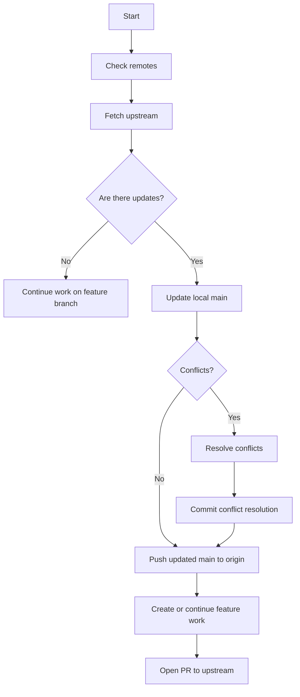
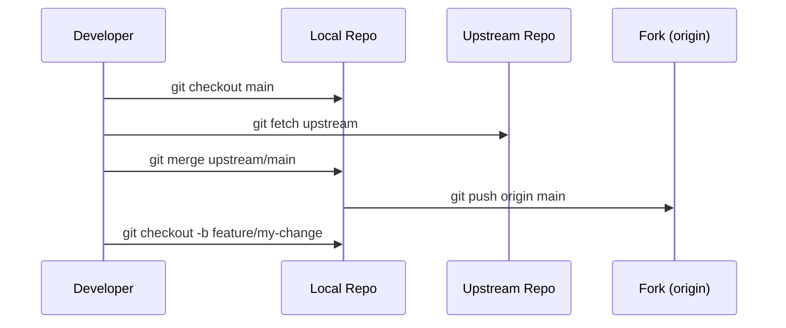
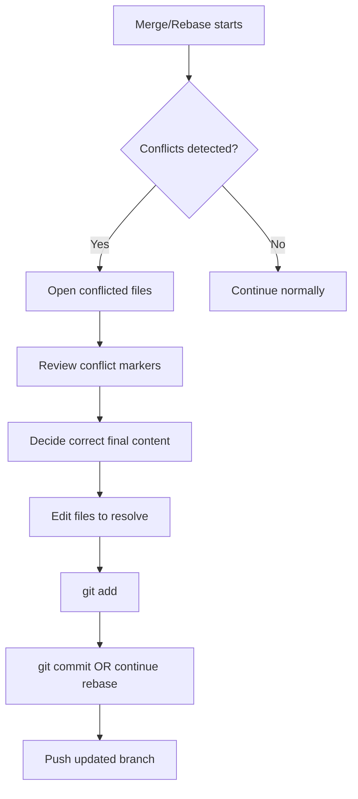
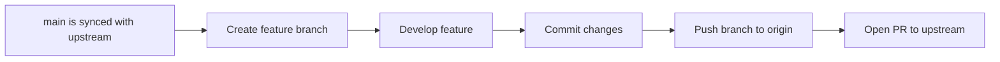
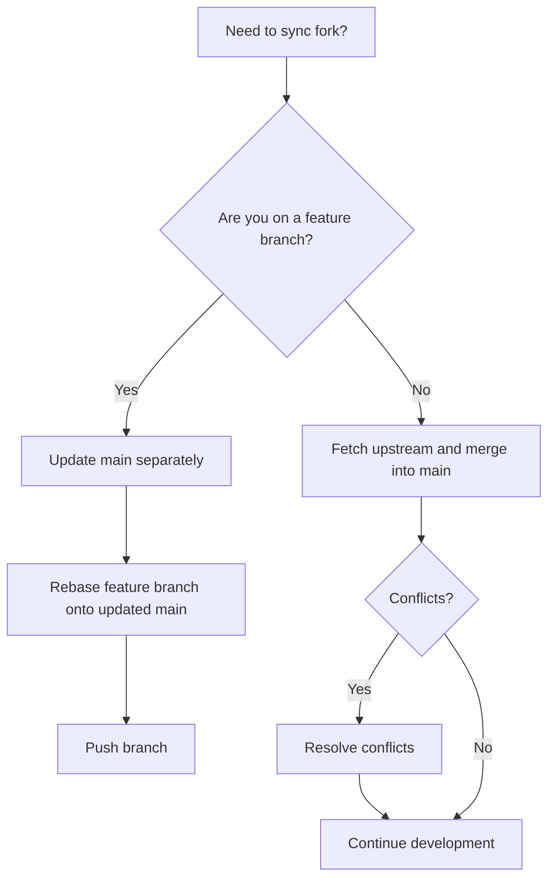

# Standard Operating Procedure (SOP): Keeping a Fork Synced with Upstream

## 1. Purpose

This procedure defines the standard process for keeping a fork of an upstream repository current, resolving conflicts safely, and continuing development without losing local or remote changes.

For this repository:

- Fork: `https://github.com/eu-cristofer/pdfcraft`
- Upstream: `https://github.com/storytold/pdfcraft`
- Default branch: `main`

---

## 2. Scope

This SOP applies to:

- Contributors working from a fork
- Developers creating feature branches from the fork
- Anyone preparing pull requests to the upstream project
- Maintenance of the fork after upstream changes are published

---

## 3. Definitions

- Fork: A personal copy of another repository.
- Upstream: The original repository that you forked from.
- Origin: Your forked repository on GitHub.
- Branch: A line of development within a repository.
- Merge: Combine changes from one branch into another.
- Rebase: Reapply your commits on top of updated code.

---

## 4. Required Tools

- Git
- GitHub account
- Terminal / shell
- Optional: GitHub web interface for quick sync

---

## 5. Standard Workflow

### 5.1 Overview



---

### 5.2 Initial Setup (One-Time)

If the upstream remote is not configured yet:

```bash
git remote -v
git remote add upstream https://github.com/storytold/pdfcraft.git
git fetch upstream
git remote -v
```

Expected result:

- `origin` = your fork
- `upstream` = original repository

---

### 5.3 Weekly / Before Major Work

Before starting new work, update your local `main` branch with the latest upstream changes:

```bash
git checkout main
git fetch upstream
git merge upstream/main
git push origin main
```

If there are no conflicts, the repository is now synchronized.

---

## 6. Handling Updates Safely

### 6.1 Standard Sync Process



This is the safe default process for fork maintenance.

---

### 6.2 Rebase Option

Use rebase when you want a cleaner commit history on your own branch.

```bash
git checkout main
git fetch upstream
git rebase upstream/main
git push --force-with-lease origin main
```

Important:
- Rebase is best used on your own local branch or feature branch
- Avoid rebasing shared branches
- Use `--force-with-lease` instead of `--force` to reduce accidental overwrite risk

---

## 7. Conflict Resolution Procedure

If `git merge` or `git rebase` reports conflicts:



### Example conflict resolution flow

```bash
git status
git diff
# resolve file conflicts manually
git add path/to/resolved-file
git commit
# or, during rebase:
git add path/to/resolved-file
git rebase --continue
```

If the rebase gets stuck:

```bash
git rebase --abort
```

Then retry after reviewing the changes.

---

## 8. Feature Branch Workflow

Use a dedicated branch for work instead of making commits directly on `main`.



Commands:

```bash
git checkout main
git pull upstream main
git checkout -b feature/my-change
# make changes
git add .
git commit -m "Add my feature"
git push origin feature/my-change
```

---

## 9. Pull Request Workflow

Once the branch is ready:

1. Push the branch to your fork
2. Open a Pull Request against the upstream repository
3. Ensure the PR is based on the upstream branch
4. Include a clear title and summary

Typical flow:

```bash
git push origin feature/my-change
```

Then open the PR from GitHub:
- base repository: `storytold/pdfcraft`
- base branch: `main`
- compare branch: `eu-cristofer:feature/my-change`

---

## 10. Browser Sync Option (Optional)

GitHub also offers a browser-based sync button. This is acceptable for quick updates, but local Git is recommended for full control and conflict handling.

### Browser process
1. Open your fork on GitHub
2. Click “Sync fork”
3. Pull the updated branch locally

```bash
git checkout main
git pull origin main
```

---

## 11. Decision Matrix



---

## 12. Recommended Daily Practice

- Keep `main` synchronized with upstream
- Work on feature branches, not directly on `main`
- Update branches before opening a PR
- Resolve conflicts early
- Push small, reviewable commits
- Do not rewrite shared branches

---

## 13. Standard Command Set

This is the shortest practical version:

```bash
git remote add upstream https://github.com/storytold/pdfcraft.git
git fetch upstream
git checkout main
git merge upstream/main
git push origin main
```

For a feature branch:

```bash
git checkout -b feature/my-change
git push origin feature/my-change
```

For syncing a feature branch with the updated `main`:

```bash
git checkout feature/my-change
git fetch upstream
git rebase upstream/main
git push --force-with-lease origin feature/my-change
```

---

## 14. Recommended Operational Rule

The standard rule is:

- `origin` = your fork
- `upstream` = original project
- `main` = always kept aligned with upstream
- feature branches = your development work

This keeps projects consistent, minimizes divergence, and avoids losing upstream changes.

---

## 15. Summary

The fork maintenance standard for this repository is:

```bash
git remote add upstream https://github.com/storytold/pdfcraft.git
git fetch upstream
git checkout main
git merge upstream/main
git push origin main
```

Then continue work on a feature branch and open PRs against upstream.

---

## 16. Quick Reference

```bash
# One-time setup
git remote add upstream https://github.com/storytold/pdfcraft.git

# Sync main
git checkout main
git fetch upstream
git merge upstream/main
git push origin main

# New feature
git checkout -b feature/my-change
git push origin feature/my-change

# Rebase feature branch onto current upstream
git checkout feature/my-change
git fetch upstream
git rebase upstream/main
git push --force-with-lease origin feature/my-change
```

---

If you want, I can also help you create the exact final file path and branch commit message, or format it into a more formal internal documentation style.
