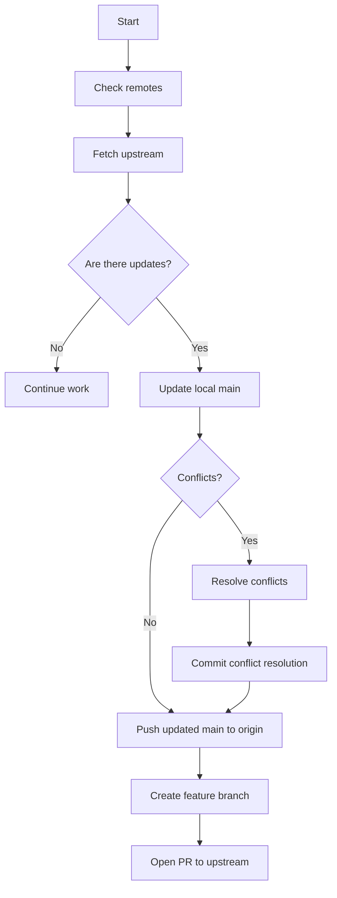

# Standard Operating Procedure (SOP): Keeping a Fork Synced with Upstream

## 1. Purpose

This procedure defines the standard process for keeping a fork of an upstream repository current, resolving conflicts safely, and continuing development without losing local or remote changes.

For this repository:

- Fork: `https://github.com/eu-cristofer/pdfcraft`
- Upstream: `https://github.com/storytold/pdfcraft`
- Default branch: `main`

---

## 2. Scope

This SOP applies to:

- Contributors working from a fork
- Developers creating feature branches from the fork
- Anyone preparing pull requests to the upstream project
- Maintenance of the fork after upstream changes are published

---

## 3. Definitions

- Fork: A personal copy of another repository.
- Upstream: The original repository that you forked from.
- Origin: Your forked repository on GitHub.
- Branch: A line of development within a repository.
- Merge: Combine changes from one branch into another.
- Rebase: Reapply your commits on top of updated code.

---

## 4. Standard Workflow

### 4.1 Initial setup (one-time)

If the upstream remote is not configured yet:

```bash
git remote -v
git remote add upstream https://github.com/storytold/pdfcraft.git
git fetch upstream
git remote -v
```

Expected result:

- `origin` = your fork
- `upstream` = original repository

### 4.2 Sync local `main` with upstream

Before starting new work, update your local `main` branch with the latest upstream changes:

```bash
git checkout main
git fetch upstream
git merge upstream/main
git push origin main
```

If there are no conflicts, the repository is now synchronized.

---

## 5. Recommended Git Flow



---

## 6. Feature branch workflow

Use a dedicated branch for work instead of making commits directly on `main`.

```bash
git checkout main
git pull upstream main
git checkout -b feature/my-change
# make changes
git add .
git commit -m "Add my feature"
git push origin feature/my-change
```

---

## 7. Conflict resolution

If `git merge` or `git rebase` reports conflicts:

```bash
git status
git diff
# resolve file conflicts manually
git add path/to/resolved-file
git commit
# or, during a rebase:
git add path/to/resolved-file
git rebase --continue
```

If a rebase gets stuck:

```bash
git rebase --abort
```

---

## 8. Rebase option

Use rebase when you want a cleaner history on your own branch.

```bash
git checkout main
git fetch upstream
git rebase upstream/main
git push --force-with-lease origin main
```

Important:

- Rebase is best used on your own feature branch
- Avoid rebasing shared branches
- Use `--force-with-lease` instead of `--force`

---

## 9. Browser sync option

GitHub also offers a browser-based "Sync fork" button. This is acceptable for quick updates, but local Git is recommended for full control and conflict handling.

```bash
git checkout main
git pull origin main
```

---

## 10. Operational rule

The standard rule is:

- `origin` = your fork
- `upstream` = original project
- `main` = always kept aligned with upstream
- feature branches = your development work

This keeps the project consistent and minimizes divergence from the upstream repository.

---

## 11. Quick reference

```bash
# One-time setup
git remote add upstream https://github.com/storytold/pdfcraft.git

# Sync main
git checkout main
git fetch upstream
git merge upstream/main
git push origin main

# Create feature branch
git checkout -b feature/my-change
git push origin feature/my-change

# Rebase feature branch onto current upstream
git checkout feature/my-change
git fetch upstream
git rebase upstream/main
git push --force-with-lease origin feature/my-change
```

---

## 12. Summary

Use this default sync pattern for this repository:

```bash
git remote add upstream https://github.com/storytold/pdfcraft.git
git fetch upstream
git checkout main
git merge upstream/main
git push origin main
```

Then continue work on a feature branch and open PRs against upstream.
