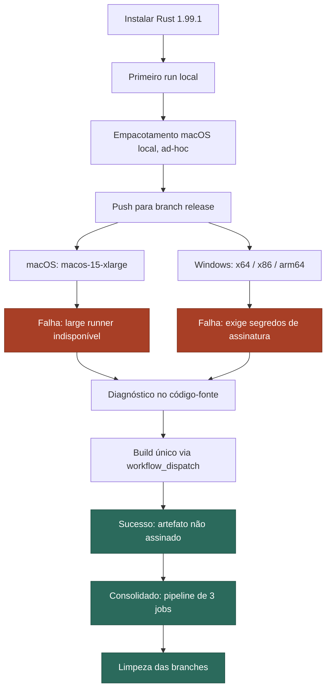
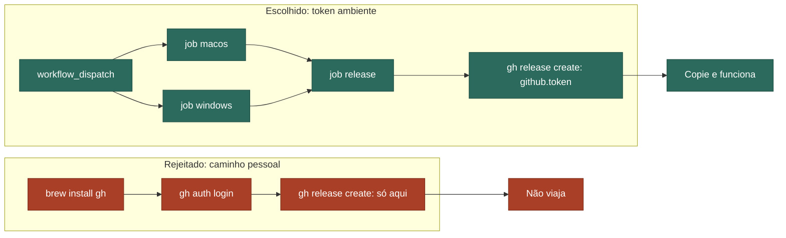

<!-- _class: lead -->

# Tecnoindependência, na Prática

Um estudo de caso real de engenharia de software
**PdfCraft** · distribuição para macOS e Windows

---

## Agenda

1. O que é "tecnoindependência" aqui
2. O caso, de ponta a ponta
3. Lição 1 — Independência de infraestrutura
4. Lição 2 — Confiança e proveniência
5. Lição 3 — Automação que viaja
6. Princípios e discussão

---

## 1. O que é "tecnoindependência"?

- **Não é** autossuficiência total nem recusar infraestrutura de terceiros
- **É** saber precisamente:
  - o que você controla
  - o que você está tomando de empréstimo
  - o que quebra se o empréstimo for retirado

> "A capacidade de exercer autoridade legítima sobre domínios digitais por meio da configuração
> de infraestruturas, interdependências e práticas." — Wang et al. (2026)

---

## O paralelo comercial: *vendor lock-in*

- Migrar de um provedor custa mais do que deveria
- Porque a dependência nunca foi tornada explícita **enquanto tudo funcionava**
  (Opara-Martins et al., 2016)

O pipeline deste caso é uma rejeição desse padrão, em escala de um único workflow de CI.

---

## 2. O caso, de ponta a ponta

Objetivo mundano: rodar o `pdfcraft` localmente, depois distribuí-lo.

O caminho não foi mundano:

local funcionando → CI falha por **dois motivos independentes** → diagnóstico no código de
terceiros → reconstrução com **menos** dependências

---



---

## 3. Lição 1 — Independência de infraestrutura

**Falha:** `runs-on: macos-15-xlarge`

- Runner *grande*, hospedado pelo GitHub
- Exige plano Team/Enterprise — **indisponível** em conta pessoal
- Falha em < 4s, antes de qualquer etapa rodar

---

## Isso não era um bug

Era uma dependência **assumida deliberadamente** pelo pipeline original — builds mais rápidos,
infraestrutura paga que a organização dona possui.

Herdada sem crítica → dependência de fornecedor não examinada
(Opara-Martins et al., 2016)

**Correção:** `runs-on: macos-14` — nível padrão, gratuito, mesmo script.

---

## 4. Lição 2 — Confiança não é burocracia

Toda build Windows falhava aqui:

```yaml
- name: Require signing secrets on the release branch
  if: github.ref == 'refs/heads/release'
```

Uma única condição. Um controle de proveniência real.

---

## Por que esse *gate* existe

Binários não assinados = superfície de ataque catalogada em taxonomias reais de ataque à cadeia
de suprimentos de código aberto (Ohm et al., 2020).

Assinatura *ad-hoc* (o que fizemos) ≠ notarização real:

- real criptograficamente
- confiável **só nesta máquina**

Builds reproduzíveis: confiança não deveria depender de aceitar a palavra do binário
(Lamb & Zacchiroli, 2022).

**Escolha deliberada:** não buscamos certificado. Artefato rotulado honestamente como não assinado.

---

## 5. Lição 3 — Automação que viaja

- 1ª correção: workflow único, disparado à mão → funcionou, mas só nesta máquina
- 2ª correção: pipeline de 3 jobs, sem **nenhuma** credencial pessoal

O mecanismo: todo runner já vem com `gh` instalado + `GITHUB_TOKEN` de curta duração, por execução.

(Shahin et al., 2017 — automação ambiente é o cerne do CI/CD)

---



---

## 6. Princípios, na ordem em que surgiram

1. **Possua seu build antes de automatizá-lo**
2. **Prefira, por padrão, o nível padrão de infraestrutura**
3. **Um build rejeitado é uma decisão a entender, não um obstáculo a contornar**
4. **Prefira a credencial que ninguém precisa digitar**

---

<!-- _class: lead -->

## Discussão

- Onde você já herdou uma dependência invisível até algo falhar?
- Quando um *gate* de segurança incondicional é a escolha certa?
- Quando vale reintroduzir segredos (certificados, notarização)?

**Exercício:** aplique `guia-portabilidade.md` a um repositório seu.

---

## Referências

Lamb & Zacchiroli (2022) · *IEEE Software, 39*(2)
Ohm et al. (2020) · DIMVA 2020, LNCS 12223
Opara-Martins et al. (2016) · *Journal of Cloud Computing, 5*(4)
Shahin et al. (2017) · *IEEE Access, 5*
Wang et al. (2026) · *Business & Information Systems Engineering*

Lista completa em `material-curso.md`.
