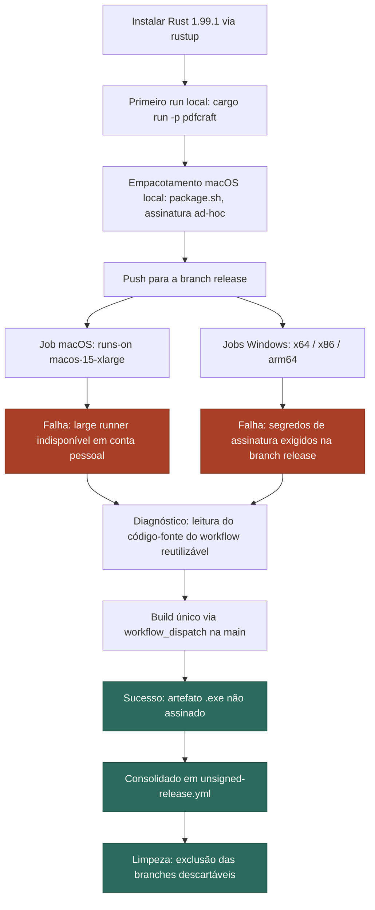
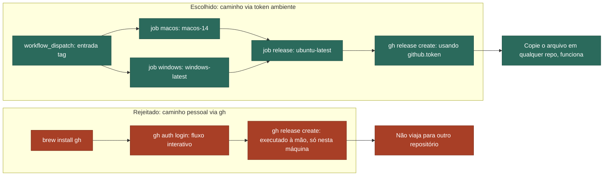

# Tecnoindependência, na Prática

### Material de curso — Engenharia de Software (nível de mestrado)

> Versão interativa (com os mesmos diagramas renderizados e navegação): artefato publicado
> "Technoindependence, Worked". Este documento é a versão para leitura, impressão e uso em sala.

---

## Ementa

Um estudo de caso real — extraído de uma sessão de engenharia sobre o projeto de código aberto
**PdfCraft** (editor de PDF nativo em Rust) — sobre o que significa, na prática, uma equipe (ou
uma única pessoa) **possuir** o seu próprio processo de build e distribuição de software, em vez
de depender de infraestrutura, credenciais pessoais ou convenções que não foram examinadas
criticamente.

**Objetivos de aprendizagem.** Ao final desta aula, a pessoa estudante deve ser capaz de:

1. Definir "tecnoindependência" em termos de engenharia de software, distinguindo-a de
   autossuficiência absoluta ou rejeição de infraestrutura de terceiros;
2. Identificar, em um pipeline de CI/CD real, quais dependências são essenciais e quais foram
   herdadas sem necessidade;
3. Explicar por que um controle de segurança (como um *gate* de assinatura de código) existe, em
   vez de apenas contorná-lo;
4. Projetar um pipeline de automação que não dependa de uma credencial pessoal, e justificar por
   que isso o torna reutilizável em outros repositórios.

---

## 1. Enquadramento — o que significa "tecnoindependência" aqui

Tecnoindependência não é autossuficiência total, nem recusa de usar infraestrutura de terceiros.
É a capacidade de dizer, com precisão, quais partes do seu processo de build você efetivamente
controla, quais partes você está apenas *tomando de empréstimo*, e o que quebra se aquilo que você
tomou de empréstimo mudar de ideia.

A literatura recente sobre soberania digital enquadra essa ideia não como
independência-por-isolamento, mas como uma **capacidade**: a habilidade de um ator — um Estado,
uma organização ou, neste caso, uma única pessoa engenheira — de "exercer autoridade legítima
sobre domínios digitais por meio da configuração de infraestruturas, interdependências e
práticas" (Wang et al., 2026, tradução livre). Esse trabalho de configuração é exatamente o que
este estudo de caso percorre: não evitar a infraestrutura do GitHub, mas entender com precisão de
quais partes dela os builds desta sessão dependiam — e substituir as que se mostraram
desnecessárias.

A versão mais comercial e adjacente desse problema é o *vendor lock-in* — o padrão bem
documentado em que migrar de um provedor de nuvem custa mais do que deveria, porque a dependência
nunca foi tornada explícita enquanto tudo funcionava (Opara-Martins et al., 2016). O pipeline
construído neste caso é uma pequena rejeição deliberada desse padrão, na escala de um único
workflow de CI: toda dependência que ele tem é ou um script de build do próprio projeto, ou um
recurso ambiente e gratuito do GitHub — nada que exija uma credencial vinculada à conta pessoal de
alguém.

---

## 2. O caso, de ponta a ponta

O objetivo era mundano: colocar o `pdfcraft` — um editor de PDF para desktop em Rust — rodando
localmente e, depois, distribuível para macOS e Windows. O caminho até lá não foi mundano. Passou
por um build local funcionando, um script de empacotamento que funcionava perfeitamente à mão, um
pipeline de CI que falhou por dois motivos independentes, um diagnóstico que exigiu ler o código
de outra equipe, e uma reconstrução de toda a abordagem em torno de um conjunto muito menor de
dependências.



*Legenda:* os nós em vermelho são onde o pipeline de release real do projeto
(`release.yml`) rejeitou o trabalho; os nós em verde-azulado são onde um pipeline menor,
construído sob medida, teve sucesso — em vez de insistir em vencer o primeiro.

---

## 3. Lição 1 — Independência de infraestrutura

**Falha observada.** O job de macOS no workflow de release real do projeto declara
`runs-on: macos-15-xlarge` — um *runner* grande hospedado pelo GitHub. Runners grandes ficam atrás
de um plano GitHub Team ou Enterprise; um fork em conta pessoal simplesmente não tem fila para
colocar esse job. Ele falhava em menos de quatro segundos, antes de qualquer etapa rodar, sempre,
independentemente de como o workflow era disparado.

Isso não é um bug para contornar com novas tentativas — é uma dependência que o pipeline original
assumiu deliberadamente, em troca de builds mais rápidos em infraestrutura paga que a organização
proprietária possui. Herdada sem crítica em um fork pessoal, a mesma escolha se torna uma
dependência de fornecedor não examinada, exatamente do tipo que a literatura sobre *lock-in* em
nuvem descreve: um custo que permanece invisível até o momento em que se tenta saber dele
(Opara-Martins et al., 2016). A correção não foi um *workaround* — foi perceber a dependência e
recusar-se a herdá-la: `runs-on: macos-14`, um runner de nível padrão que toda conta GitHub recebe
gratuitamente, constrói exatamente o mesmo script de empacotamento.

---

## 4. Lição 2 — Confiança e proveniência não são a mesma coisa que burocracia

**Falha observada.** Todo job de Windows na branch `release` falhava em uma etapa chamada,
literalmente, *"Require signing secrets on the release branch"*. Ler o código-fonte do workflow
reutilizável levou a uma única linha:

```yaml
# storytold/craft-common-actions/.github/workflows/release.yml
- name: Require signing secrets on the release branch
  if: github.ref == 'refs/heads/release'
```

Essa condição única é um controle de proveniência, não burocracia: ela existe para que nada que
chegue a essa branch específica — a que representa, de fato, um lançamento real e distribuível —
possa saltar o pipeline sem assinatura. Binários não assinados são exatamente a superfície de
ataque que taxonomias de ataques reais à cadeia de suprimentos de software de código aberto
catalogam: código malicioso injetado em uma dependência ou artefato de build, depois entregue a
uma pessoa usuária que não tem como distingui-lo do artefato legítimo (Ohm et al., 2020). Um
*gate* de assinatura é um dos controles mais baratos contra essa categoria de risco — exatamente
por isso ele é incondicional, e não opcional.

Os próprios scripts do projeto já codificam a alternativa honesta para tudo que não é um
lançamento real: quando nenhum certificado está configurado, `sign.ps1` e o script de
empacotamento de macOS recuam para um aviso explícito e uma assinatura **ad-hoc** —
criptograficamente real, mas não respaldada por uma autoridade certificadora ou pelo serviço de
notarização da Apple, e por isso confiável apenas na máquina que a produziu. A pesquisa sobre
*builds reproduzíveis* enquadra o objetivo mais amplo que isso serve: permitir que partes
independentes comparem o que um build de fato produziu com o que ele afirma ter produzido, de modo
que a confiança não precise se apoiar em aceitar a palavra do próprio binário (Lamb & Zacchiroli,
2022). Este estudo de caso nunca obteve um certificado — esse custo (uma assinatura de membro no
programa de desenvolvedores da Apple, um certificado de assinatura de código ou uma assinatura via
Azure Trusted Signing) foi deliberadamente deixado de lado. Os artefatos produzidos são rotulados
honestamente pelo que são: reais, funcionais, e não assinados.

---

## 5. Lição 3 — Automação que viaja

**O que de fato funcionou.** A primeira correção foi um workflow único, disparado por um *push*,
que apenas construía o binário Windows e o enviava como artefato de CI com validade de 90 dias.
Funcionou — mas só existia porque uma pessoa havia digitado o `git push` certo, na máquina certa.
A segunda correção incorporou esse job em um pipeline de três etapas que cria um GitHub Release de
fato, e, ao fazer isso, removeu toda dependência deste laptop específico.

O mecanismo que tornou isso possível é fácil de não notar: todo runner hospedado pelo GitHub já
vem com a CLI `gh` pré-instalada, e toda execução de workflow recebe um `GITHUB_TOKEN` de curta
duração, com alcance limitado àquele repositório — sem configuração e sem nenhuma credencial
pessoal envolvida. Revisões sistemáticas sobre prática de CI/CD tratam esse tipo de automação
ambiente, delimitada ao próprio pipeline, como o cerne da disciplina: transformar uma sequência de
etapas manuais, moldadas por uma pessoa, em algo que uma máquina executa de forma idêntica a cada
vez — o que é exatamente o que torna um processo de release algo que outros repositórios conseguem
reaproveitar (Shahin et al., 2017).



*Legenda:* os dois caminhos produzem um release. Só o da direita é um arquivo que se pode copiar
para outro repositório e executar — o da esquerda é uma sequência de ações que uma pessoa fez em
um laptop específico.

---

## 6. Princípios — na ordem em que surgiram

1. **Possua o seu build antes de automatizá-lo.** Um script de empacotamento que funciona
   corretamente à mão é a especificação do pipeline — não um rascunho a ser substituído por ele.
2. **Prefira, por padrão, o nível padrão de infraestrutura.** Recorra a infraestrutura paga ou
   privilegiada só depois que o nível padrão de fato falhar em cumprir a tarefa — não porque o
   pipeline de onde você copiou por acaso a utilizava.
3. **Um build rejeitado é uma decisão de projeto a ser lida, não um obstáculo a ser contornado.**
   O *gate* de assinatura não era um bug; entendê-lo foi mais rápido do que lutar contra ele, e nos
   disse exatamente o que estávamos optando por não fazer.
4. **Prefira a credencial que ninguém precisa digitar.** Um pipeline autenticado pela própria
   execução — não pelo login de uma pessoa — é o que continua funcionando depois que você já
   esqueceu como o configurou.

---

## 7. Questões para discussão

1. Em qual outro contexto de engenharia (fora de CI/CD) você já herdou, sem perceber, uma
   dependência de infraestrutura que só ficou visível quando algo falhou?
2. O *gate* de assinatura do `release.yml` é incondicional. Em que situações um controle de
   segurança incondicional é a escolha certa, e em quais ele deveria admitir exceções explícitas e
   documentadas?
3. Compare a assinatura *ad-hoc* com a notarização real. Quais garantias cada uma oferece, e para
   qual público cada uma é suficiente?
4. O princípio 2 ("prefira o nível padrão") tem um custo: builds mais lentos, potencialmente
   menos paralelismo. Em que ponto esse custo passaria a justificar voltar a depender de
   infraestrutura paga?
5. Esse caso termina em um pipeline de três jobs sem nenhum segredo. Em que ponto, no roadmap real
   de distribuição de um projeto, seria necessário reintroduzir segredos (certificados de
   assinatura, notarização) — e o que muda em termos de governança quando isso acontece?

### Exercício prático

Aplique o `guia-portabilidade.md` (neste mesmo diretório) a um repositório seu. Relate, por
escrito: (a) o que precisou ser adaptado além dos nomes de binário; (b) se o seu repositório já
tinha algum script de empacotamento equivalente ao `packaging/macos/package.sh`, ou se você
precisou escrever os comandos de build diretamente no workflow; (c) se algum runner de nível
padrão se mostrou insuficiente para o seu caso, e por quê.

---

## Referências

Lamb, C., & Zacchiroli, S. (2022). Reproducible builds: Increasing the integrity of software
supply chains. *IEEE Software, 39*(2), 62–70. https://ieeexplore.ieee.org/document/9403390

Ohm, M., Plate, H., Sykosch, A., & Meier, M. (2020). Backstabber's knife collection: A review of
open source software supply chain attacks. In *Detection of Intrusions and Malware, and
Vulnerability Assessment* (DIMVA 2020), Lecture Notes in Computer Science, vol. 12223 (pp. 23–43).
Springer. https://doi.org/10.1007/978-3-030-52683-2_2

Opara-Martins, J., Sahandi, R., & Tian, F. (2016). Critical analysis of vendor lock-in and its
impact on cloud computing migration: A business perspective. *Journal of Cloud Computing:
Advances, Systems and Applications, 5*(4). https://doi.org/10.1186/s13677-016-0054-z

Shahin, M., Babar, M. A., & Zhu, L. (2017). Continuous integration, delivery and deployment: A
systematic review on approaches, tools, challenges and practices. *IEEE Access, 5*, 3909–3943.
https://doi.org/10.1109/ACCESS.2017.2685629

Wang, B., Ciriello, R. F., & Richter, A. (2026). Digital sovereignty. *Business & Information
Systems Engineering*. https://doi.org/10.1007/s12599-026-01018-9

---

## Nota sobre conversão para PDF

Este arquivo usa blocos ` ```mermaid ` para os dois diagramas. Eles renderizam nativamente no
GitHub. Para gerar um PDF:

- **Com diagramas renderizados:** use `marp-cli` (`npx @marp-team/marp-cli material-curso.md
  --pdf --allow-local-files`), que executa Mermaid.js ao renderizar.
- **Com `pandoc` puro:** `pandoc material-curso.md -o material-curso.pdf` funciona, mas os blocos
  Mermaid saem como texto de código, não como diagrama — use a rota acima se os diagramas forem
  necessários no PDF.
